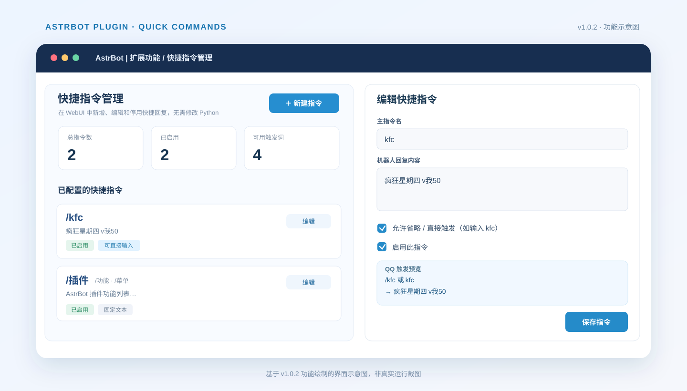

# AstrBot 快捷指令管理

**在 AstrBot WebUI 里配置聊天快捷指令，保存后即可使用。**

输入关键词后不经过ai，直接输出预设的回复内容。可以把 多个输入词设为同一份回复，也可以开启「允许省略 /」，例如让 `kfc` 和 `/kfc` 都触发自定义消息。

**当前版本：v1.0.2** · [GitHub 仓库](https://github.com/DreemurrL/astrbot_plugin_quick_commands)

## 功能介绍

| 功能 | 说明 |
| --- | --- |
| **WebUI 可视化管理** | 在 AstrBot「扩展功能 → 快捷指令管理」中新增、编辑、启停和删除规则 |
| **自定义触发词与别名** | 一条规则可以同时响应多个关键词，如 `/kfc`、`/肯德基`、`/疯狂星期四` 等 |
| **免斜杠触发（v1.0.2）** | 可为每条规则单独开启，支持直接发送 `kfc` 触发；默认关闭 |
| **自定义回复** | 填写固定文字，或导入 UTF-8 编码的 TXT 文本 |
| **权限与参数** | 可设置「仅管理员可用」或「允许附带参数」，回复内容可使用 `{args}` 占位符 |
| **无需重启生效** | 在 WebUI 中保存修改后，后续消息使用最新规则 |
| **数据持久化** | 规则保存在 AstrBot 的 `plugin_data` 目录中，正常升级插件不会覆盖 |

本插件处理的是**文字快捷回复**，并非其他 AstrBot 插件的指令转发器。

## 界面预览



> 上图是根据 v1.0.2 的页面结构和功能绘制的**界面示意图**，并非在真实 AstrBot 实例中截取的截图。实际界面可能因 WebUI 主题和窗口大小而略有不同。

例如创建一条规则：

- **主指令：** `kfc`
- **回复内容：** `疯狂星期四 v我50`
- **开启：**「允许省略 / 直接触发」

| QQ 消息 | 结果 |
| --- | --- |
| `/kfc` | 回复「疯狂星期四 v我50」 |
| `kfc` | 回复「疯狂星期四 v我50」 |
| `今天想吃kfc吗` | 不触发：关键词须精确匹配 |
| `kfc abc` | 仅当同时开启「允许附带参数」时触发 |

> 「免斜杠触发」不改变 AstrBot 的全局唤醒前缀，只针对该条已启用规则的关键词生效。别名共享同一规则的设置。

## 适用范围

- **AstrBot 版本：** v4.29.0 及以上、5.0 以下；主要针对 **v4.29.1** 的唤醒和 Plugin Views 机制开发。
- **平台：** 重点面向 QQ 官方机器人（`qq_official`）和 OneBot（`aiocqhttp`）；其他适配器未专门测试。
- **管理入口：** 需要可访问 AstrBot WebUI 的「扩展功能 / 插件视图」。
- **回复类型：** 普通文字消息、固定内容和导入的 TXT 正文；不提供执行 Shell 命令、文件下载、调用其他插件指令等功能。

适配器的消息接收权限、QQ 官方机器人的平台限制及 AstrBot 本身的会话管理设置仍然适用。插件不会绕过平台规则。

## 安装方法

### 推荐：通过 GitHub 仓库地址安装

1. 进入 **AstrBot WebUI → 插件 → 已安装 → 安装插件（+）**。
2. 选择 **从链接安装**，粘贴下列地址：

   ```text
   https://github.com/DreemurrL/astrbot_plugin_quick_commands
   ```

3. 点击安装，启用插件；如未立即出现入口，请刷新 WebUI。
4. 打开左侧 **扩展功能 → 快捷指令管理**（也可从插件详情打开视图）。
5. 点击「新建指令」，填写主指令、可选别名和回复内容，保存即可。

> 无需下载单独发布的 ZIP 安装包。当前插件也尚未确认收录于 AstrBot 官方插件市场；在此之前请使用上面的 GitHub 仓库地址安装。

### 安装后快速上手

例如配置一份功能菜单：

| 配置项 | 示例 |
| --- | --- |
| 主指令 | `插件` |
| 其他别名 | `功能, 菜单` |
| 回复来源 | 固定文本，或导入 UTF-8 TXT |
| 回复内容 | 你希望机器人输出的功能列表 |
| 允许省略 `/` | 按需勾选，默认关闭 |

保存后，在 QQ 发送 `/插件`、`/功能` 或 `/菜单`，即可收到同一份菜单内容。如果勾选免斜杠触发，还可以直接发送 `插件` 或 `功能`。

TXT 导入会**将文件内容写入规则数据**，而不是持续关联上传时的原始 TXT 文件路径。修改回复可直接在 WebUI 中编辑或重新导入。

## 更新说明

### v1.0.2 · 免斜杠触发

- 为每条指令新增「允许省略 / 直接触发」独立开关。
- 同时支持 `/kfc` 和 `kfc`，采用完整关键词匹配，不会把句子中的某个词误当作快捷指令。
- 根据 AstrBot v4.29.1 的唤醒检查流程，加入仅匹配有效规则时生效的唤醒过滤器。
- 兼容旧版规则数据：既有规则的免斜杠选项默认关闭。

### v1.0.1 · QQ 指令兼容修复

- 修复 AstrBot 在唤醒过程中处理 `/` 前缀后，动态规则可能无法匹配的问题。
- 改为从原始文字消息组件识别指令，提升 QQ 平台兼容性。

### v1.0.0 · 初始版本

- 提供 AstrBot WebUI 扩展管理页面。
- 支持自定义文字回复、TXT 导入、多个别名、启停、编辑、删除及管理员权限设置。

## 数据保存与升级

规则默认保存在：

```text
data/plugin_data/astrbot_plugin_quick_commands/shortcuts.json
```

升级前建议备份此文件；升级同名插件时**不要手动删除**上述数据目录。升级后刷新 WebUI 并检查规则是否保留。

普通消息中不要配置过于常见的免斜杠关键词（如 `你好`、`谢谢`），否则当其他人发送完全相同的文字时，也会触发回复。

已存在的 AstrBot 内置或第三方插件指令可能与自定义快捷词冲突。建议避免使用已有名称；例如你还安装了其他实现 `/插件` 的插件时，应先确认只有一处负责这条指令。

快捷词通过动态消息监听实现，不会逐条出现在 AstrBot 原生「管理行为 → 指令」列表中，也不会自动加入 `/help`。QQ 平台对长消息和发送频率的限制仍可能影响回复。

## 项目创作与维护

**本插件及其文档由 OpenAI ChatGPT 创作。** GitHub 仓库由 [DreemurrL](https://github.com/DreemurrL) 发布，用于分享与后续维护。

代码已进行离线语法和模拟测试，但并不表示已经覆盖所有 AstrBot 版本与平台环境。欢迎通过本仓库的 [Issues](https://github.com/DreemurrL/astrbot_plugin_quick_commands/issues) 反馈安装问题或功能建议。

相关参考：[AstrBot 项目](https://github.com/AstrBotDevs/AstrBot) · [AstrBot 官方文档](https://docs.astrbot.app/)
